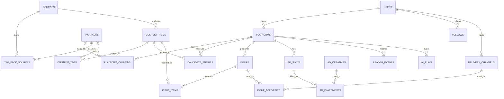

# 用户自建信息平台：核心数据模型

这份文档是「用户自建信息平台」的数据真源。  
SQL 实现见 [`db/schema.sql`](../db/schema.sql)，核心种子数据见 [`db/seed-core.sql`](../db/seed-core.sql)。

## 1. 产品对象一句话

用户注册后拥有一个 `users` 记录；用户可以创建一个或多个 `platforms`。  
每个平台由若干 `platform_columns` 组成；每天从 `content_items` 里生成 `candidate_entries`；审稿通过后生成 `issues` 和 `issue_items`；再通过 `delivery_channels` 分发。

```text
users
  → platforms
    → platform_columns
    → candidate_entries（每日候选池）
    → issues / issue_items（当期日报）
    → delivery_channels / issue_deliveries（分发）
```

关注、广告、阅读行为、AI 审计、版权投诉都挂在这条主线旁边。

## 2. 实体关系图



## 3. 表分组

### 3.1 账号与平台

| 表 | 作用 |
|---|---|
| `users` | 注册用户；邮箱或手机号至少一个 |
| `platforms` | 用户搭建的信息平台，核心对象 |
| `platform_columns` | 用户平台的栏目，栏目固定才能形成阅读习惯 |

关键字段：

- `platforms.visibility`: `private` / `unlisted` / `public`
- `platforms.ai_mode`: `manual` / `assisted` / `auto`
- `platforms.review_policy`: `human_all` / `human_confirm` / `auto_trusted`
- `platform_columns.source_mode`: `tag_pack` / `followed_platform` / `manual` / `mixed`

### 3.2 标签、信息源、版权

| 表 | 作用 |
|---|---|
| `tag_packs` | 我们预配置的内容包，如搞笑、开源、AI 资讯 |
| `sources` | 信息源 |
| `tag_pack_sources` | 内容包与信息源的多对多关系 |
| `content_items` | 统一内容对象 |
| `content_bodies` | 仅授权内容可存正文 |
| `content_tags` | 内容与标签包的关系 |

版权字段集中在 `sources` 和 `content_items`：

- `rights_status`: `unknown` / `authorized` / `official_api` / `cc_licensed` / `public_domain` / `blocked`
- `allow_snippet`: 是否允许短摘要
- `allow_image`: 是否允许展示图片
- `allow_fulltext`: 是否允许全文
- `allow_cache`: 是否允许缓存
- `takedown_contact`: 投诉联系方式

默认策略：

> `unknown` 源只允许展示标题、短导读、原文链接，不允许缓存正文或转存图片。

### 3.3 每日候选、审稿与发布

| 表 | 作用 |
|---|---|
| `candidate_entries` | 每个平台每日候选池 |
| `issues` | 每期日报 |
| `issue_items` | 当期日报里的具体条目 |

流程：

```text
content_items
  → candidate_entries（AI 打分 + 去重 + 分栏）
  → 用户 / AI 审稿
  → issues + issue_items
  → digest_json
  → 邮件 / Telegram / 站内页 / Feed
```

`issues.digest_json` 和当前项目的 `digest.json` 概念一致，后续可由它驱动邮件、Telegram、网页和 agent。

### 3.4 关注与分发

| 表 | 作用 |
|---|---|
| `follows` | 用户关注平台、栏目或标签包 |
| `delivery_channels` | 邮箱、Telegram、WebPush、RSS |
| `issue_deliveries` | 每期对每渠道的发送状态，保证幂等 |

关注是增长核心：

- 关注标签包：最简单；
- 关注栏目：更精准；
- 关注平台：让一个用户搭建的平台成为另一个用户的内容源。

`delivery_channels.send_mode` 默认是 `reminder`：

> 只提醒用户回站查看，不默认发送全文，降低版权与送达风险。

### 3.5 广告

| 表 | 作用 |
|---|---|
| `ad_slots` | 用户平台里的广告位 |
| `ad_creatives` | 广告素材 |
| `ad_placements` | 广告投放排期 |
| `ad_events` | 曝光与点击 |

第一阶段只做两类：

1. 用户自己的推广位；
2. 平台公共推荐位。

不急着做复杂广告网络。

### 3.6 审计、事件、投诉

| 表 | 作用 |
|---|---|
| `reader_events` | 阅读、收藏、打开原文、分享等行为 |
| `ai_runs` | AI 每一阶段调用的审计 |
| `rights_complaints` | 版权 / 肖像 / 广告投诉 |
| `audit_logs` | 人工操作日志 |

这些表决定产品能不能长期可信运营。

## 4. 与现有 digest 的映射

当前已有 `digest.json` 结构：

- `date` → `issues.issue_date`
- `title` / `summary` → `issues.title` / `issues.summary`
- `tabs[]` → `platform_columns` + `issue_items`
- `tabs[].highlights[]` → `content_items` + `issue_items`
- `issueUrl` → `issues.public_url`
- `feedUrl` / `subscribeUrl` → 平台配置生成，不入主表

后续建议：

> `issues.digest_json` 作为发布快照，永久保留当时那期日报的渲染输入。

这样即使源内容改了，历史日报仍然可复现。

## 5. 第一阶段实现顺序

不要一次把 20 张表全部接进业务。建议按这个顺序：

1. `users`
2. `platforms`
3. `tag_packs`
4. `platform_columns`
5. `sources`
6. `content_items`
7. `candidate_entries`
8. `issues`
9. `issue_items`
10. `delivery_channels`
11. `follows`
12. `reader_events`
13. `ad_slots` / `ad_creatives` / `ad_placements`
14. `rights_complaints` / `audit_logs`
15. `ai_runs`

第一阶段最小闭环只需要前 10 张表。

## 6. 后端适配

这套 SQL 是 PostgreSQL / Supabase 兼容的。

### Supabase

- Auth 可对接 `users.id`；
- PostgREST 提供 REST API；
- Storage 存用户上传素材；
- Edge Functions 跑抓取、AI、发送；
- RLS 按 `owner_user_id` 隔离平台数据。

### WorkBuddy 内置云服务

- Auth → `users`
- Database → 所有业务表
- Storage → 用户上传素材
- LLM → AI 摘要与筛选
- 应用层负责身份约束与读写权限

### Cloudflare D1

- UUID 可保留为 TEXT；
- `jsonb` → TEXT；
- `timestamptz` → INTEGER unix ms；
- CHECK / 触发器需按 D1 能力裁剪。

## 7. 校验

```bash
npm run db:check
```

该命令只做静态结构校验：确认核心表、关键字段、索引和版权字段存在。  
它不连接数据库，不执行 DDL。
